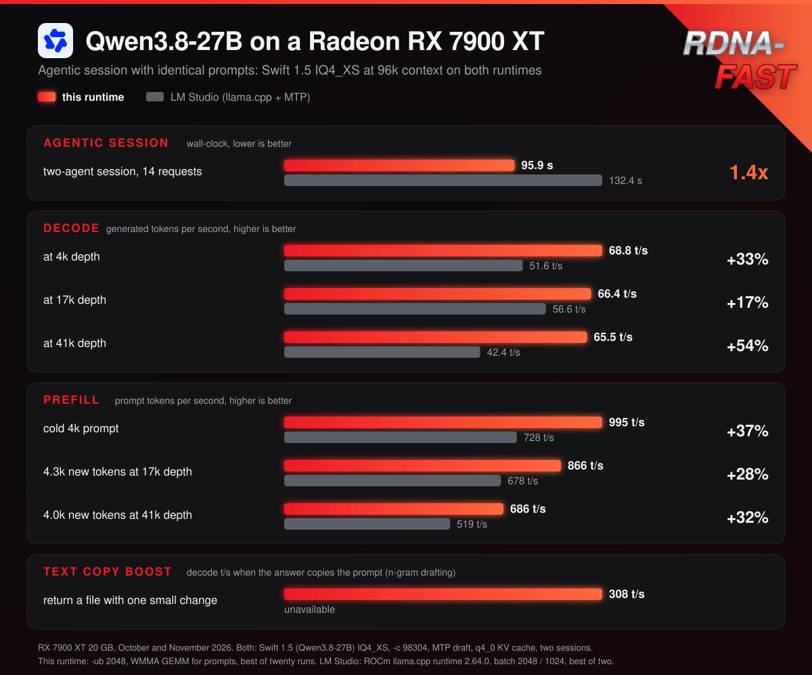

# RDNA-FAST agent server

**Local agents on AMD consumer GPUs, RDNA3 and newer.** A light-speed
`llama-server` runtime optimized for **agentic work**: long tool-calling
sessions, several agents sharing one GPU, ideal for Hermes. It works incredibly
well with **Qwen3.8-27B**, with 96k tokens of context on a 20 GB RX 7900 XT.
Built on [ROCmFPX](https://github.com/ROCmFPX/ROCmFPX) (its FP4/FP6 weight
formats) and [llama.cpp](https://github.com/ggml-org/llama.cpp).
[Other cards](#other-cards)


## Highlights

- **Faster agent loops than LM Studio on the same card.** Leveraging ROCm 10
  for maximum performance. With the same model, quant and context, a scripted
  two-agent session finishes in 93 s instead of 130 s. [Numbers](#speed)

- **Multi-token prediction.** The model's own MTP head drafts tokens ahead: up
  to 60 t/s on prose and 96 t/s on code. When an answer repeats text from the
  prompt, as code edits do, n-gram drafting copies it at up to 315 t/s.

- **Prompts on the matrix cores.** Prompt processing runs on RDNA3's WMMA units
  through [rocm_wmma_gemm](https://github.com/adelj88/rocm_wmma_gemm) by Adel
  Johar, for the stock 4-bit quants as well as the ROCmFPX formats.
  [More](#prompts-through-a-wmma-gemm)

- **96k tokens of context on a 20 GB card** with
  [Swift 1.5 IQ4_XS](https://huggingface.co/ukisai/Swift-1.5-Qwen3.8-27B-GGUF/blob/main/Swift-1.5-Qwen3.8-27B-IQ4_XS.gguf),
  UkisAI's Qwen3.8-27B fine-tune, our recommended model. For slightly faster
  prompts, our ROCmFPX-optimised quant of the same model:
  [ROCmFP4-FP6 recipe](docs/rocmfpx/swift-1.5-qwen3.8-27b-rocmfp4-fp6.md)

- **Switching conversations costs seconds, not minutes.** Conversations are
  saved to SSD and restored when they come back, in about 3 s instead of a
  minute or more of re-reading, even after a restart. New conversations pick up
  from the system prompt and tools they share with earlier ones.
  [More](#the-ssd-prompt-cache)

- **Several agents on one GPU.** Two conversations share one memory pool, so a
  second agent runs beside the first, and an idle one costs nothing.
  [More](#several-slots-on-one-gpu)

- **Vision** for screenshots and photos.

- **A decision classifier on the same port**: yes/no, choice and score answers
  with calibrated probabilities, from a small model on the CPU.

- **Request priority**, so the most urgent agent goes first. [More](#request-priority)

- **Fails fast when busy.** Requests are turned away once a few are waiting, so
  a client can fall back to another server.

Measured on one machine: RX 7900 XT 20 GB, Ryzen 9 7900, 32 GB RAM,
Windows 11, ROCm 10.1, one NVMe for models and cache. Nothing here has
been measured on an XTX. The first speed table, the IQ4_XS row and the decode
and cold-prompt tables below were measured with ROCm 10.1, the rest with ROCm
7.2.

## Speed



Against LM Studio on the same card, with the same model, quant and context: one
scripted two-agent session with identical prompts (14 requests; an orchestrator
grows from 4k to 41k tokens, a 10k-token worker is called twice in between):

| | LM Studio + MTP draft | this runtime |
|---|---:|---:|
| **the session, wall-clock** | **130 s** | **93 s** |
| prefill t/s, cold 4k prompt | 738 | 1,035 |
| prefill t/s, 4.3k new tokens at 17k depth | 705 | 887 |
| prefill t/s, 4.0k new tokens at 41k depth | 543 | 708 |
| decode t/s at 4k depth | 48.6 | 70.1 |
| decode t/s at 17k depth | 56.1 | 66.7 |
| decode t/s at 41k depth | 49.2 | 65.3 |
| decode t/s, text copy boost: code edit that copies the prompt | unavailable | 315 |

<sub>October and November 2026. Both run Swift 1.5 IQ4_XS at `-c 98304` with MTP drafting,
flash attention, a q4_0 KV cache and two sessions, the best run for each value
(LM Studio: two runs, this runtime: the last four, all on ROCm 10.1). LM Studio is its
ROCm llama.cpp runtime 2.69.0 with batch 2048 / 1024; this runtime runs the quick
start below on ROCm 10.1.
The edit row is the text copy boost, n-gram drafting, the best of the twelve edits in those runs;
LM Studio cannot run it, as its API does not switch Swift 1.5's thinking
off.</sub>

The same session with each quant we tested:

| quant | size | session, this runtime | session, LM Studio | prefill t/s at 4k / 17k / 41k | decode t/s at 4k / 17k / 41k | code edit t/s |
|---|---:|---:|---:|---:|---:|---:|
| [Q4_K_M](https://huggingface.co/ukisai/Swift-1.5-Qwen3.8-27B-GGUF/blob/main/Swift-1.5-Qwen3.8-27B-Q4_K_M.gguf)\* | 17.4 GB | 146.8 s | 1,211 s (spill) | 408 / 548 / 431 | 50.6 / 50.8 / 48.2 | 238 |
| [Q4_K_S](https://huggingface.co/ukisai/Swift-1.5-Qwen3.8-27B-GGUF/blob/main/Swift-1.5-Qwen3.8-27B-Q4_K_S.gguf) | 16.4 GB | 112.6 s | 1,139 s (spill) | 889 / 769 / 616 | 49.2 / 51.7 / 48.8 | 247 |
| [IQ4_XS](https://huggingface.co/ukisai/Swift-1.5-Qwen3.8-27B-GGUF/blob/main/Swift-1.5-Qwen3.8-27B-IQ4_XS.gguf) | 15.5 GB | 92.6 s | 130.1 s | 1,035 / 887 / 708 | 70.1 / 66.7 / 65.3 | 315 |
| [ROCmFP4-FP6](docs/rocmfpx/swift-1.5-qwen3.8-27b-rocmfp4-fp6.md) | 16.1 GB | 104.5 s | | 923 / 798 / 634 | 60.2 / 56.4 / 58.5 | 243 |

<sub>\* At 64k (`-c 65536`) and `-ub 512`: the smaller context and prompt
batches keep Q4_K_M's spill into system RAM down while staying above Hermes'
64,000-token minimum. The other quants ran at 96k with `-ub 1024`, IQ4_XS at
`-ub 2048` since. Prefill and decode are this runtime's, in the session above;
the better of two runs (IQ4_XS: the best of the last four, Q4_K_M: one). LM Studio's Q4_K_S and Q4_K_M (runtime 2.64.0) sit at the edge of
the card's memory and read every prompt again in full. ROCmFP4-FP6 is a ROCmFPX
format, which LM Studio does not load.</sub>

Decode, 450-token answers at temperature 1, the best of the last four runs
(nine answers each; without MTP from an earlier run):

| decode t/s | peak |
|---|---:|
| prose | 59.8 |
| code | 95.8 |
| without MTP, prose or code | 36.8 |

Cold prompts, each followed by a 300-token answer at that depth, the best of
the last four runs:

| | 17k | 41k | 69k |
|---|---:|---:|---:|
| prefill t/s, average over the prompt | 988 | 881 | 770 |
| decode t/s at that depth | 54.4 | 53.5 | 49.4 |

## Quick start

**1. Model.**
[`Swift-1.5-Qwen3.8-27B-IQ4_XS`](https://huggingface.co/ukisai/Swift-1.5-Qwen3.8-27B-GGUF/blob/main/Swift-1.5-Qwen3.8-27B-IQ4_XS.gguf)
(15.5 GB): [UkisAI's Swift 1.5](https://huggingface.co/ukisai/Swift-1.5-Qwen3.8-27b),
a Qwen3.8-27B fine-tune, with its MTP head, plus the
[BF16 `mmproj`](https://huggingface.co/lmstudio-community/Qwen3.8-27B-GGUF/blob/main/mmproj-Qwen3.8-27B-BF16.gguf)
of the base model for vision. Against the model's Q8_0 it picks the same top token 93.5% of
the time (mean KL divergence 0.021, wikitext-2).

The ROCmFPX-optimised alternative is our quant of the same model,
`Swift-1.5-Qwen3.8-27B-ROCmFP4-FP6` (16.1 GB): ROCmFP4 weights with 61
sensitive tensors in `Q6_0_ROCMFPX`. Its prompts run 2-5% faster, at 92.8% the
same top token (KL divergence 0.026). The
[recipe and its tensor policy file](docs/rocmfpx/swift-1.5-qwen3.8-27b-rocmfp4-fp6.md)
are in this repository.

**2. Build** with ROCm 10.1 (Ninja; about 6 minutes). AMD ships ROCm 10 for
Windows as a tarball, without an installer:
`therock-dist-windows-gfx110X-all-10.1.0.tar.gz` for RDNA3, `gfx120X-all` for
RDNA4, `gfx1151` for Strix Halo ([AMD's install guide](https://rocm.docs.amd.com/en/latest/install/rocm.html)).
Unpack it anywhere; nothing is set system-wide.

```
curl -L -o therock.tar.gz https://stable.repo.amd.com/rocm/core/tarball/therock-dist-windows-gfx110X-all-10.1.0.tar.gz
mkdir C:\TheRock\rocm-10.1
tar -xzf therock.tar.gz -C C:\TheRock\rocm-10.1 --strip-components=1

set "ROCM=C:\TheRock\rocm-10.1"
set "HIP_PATH=%ROCM%"
set "ROCM_PATH=%ROCM%"
set "HIP_PLATFORM=amd"
set "HIP_DEVICE_LIB_PATH=%ROCM%\lib\llvm\amdgcn\bitcode"
cmake -S . -B build-hip -G Ninja -DCMAKE_BUILD_TYPE=Release ^
  -DCMAKE_C_COMPILER="%ROCM%\lib\llvm\bin\clang.exe" -DCMAKE_CXX_COMPILER="%ROCM%\lib\llvm\bin\clang++.exe" ^
  -DCMAKE_RC_COMPILER="C:/Program Files (x86)/Windows Kits/10/bin/10.0.22621.0/x64/rc.exe" ^
  -DCMAKE_PREFIX_PATH="%ROCM%" -DGGML_HIP=ON -DGPU_TARGETS=gfx1100 -DCMAKE_HIP_ARCHITECTURES=gfx1100 ^
  -DGGML_HIP_GRAPHS=ON -DGGML_HIP_NO_VMM=ON -DGGML_HIP_FORCE_MMQ=ON -DGGML_CUDA_FA_ALL_QUANTS=ON ^
  -DGGML_CUDA_GRAPHS=ON -DGGML_NATIVE=ON -DGGML_OPENMP=ON -DGGML_SCHED_MAX_COPIES=4 ^
  -DLLAMA_BUILD_SERVER=ON -DLLAMA_BUILD_TOOLS=ON -DLLAMA_BUILD_TESTS=OFF -DLLAMA_CURL=OFF ^
  -DLLAMA_BUILD_WEBUI=OFF -DLLAMA_BUILD_UI=ON -DLLAMA_USE_PREBUILT_UI=OFF
cmake --build build-hip --target llama-server -j 12
```

ROCm 10.1 brings no resource compiler, so CMake takes the Windows SDK's
`rc.exe` (use the SDK version folder you have, with forward slashes). The build
copies ROCm's HIP runtime (`amdhip64_7.dll`, `amd_comgr.dll`, `rocm_kpack.dll`)
next to `llama-server.exe`: Windows would otherwise load the AMD driver's older
runtime, on which ROCm 10.1's rocBLAS fails. The UI build needs Node.js (npm);
it embeds the RDNA-FAST web UI with its live status page at
`http://127.0.0.1:<port>/#/status`. Without Node.js, use `-DLLAMA_BUILD_UI=OFF`.

**3. Run:**

```
set "PATH=C:\TheRock\rocm-10.1\bin;%PATH%"
set GGML_CUDA_NO_PINNED=1
set LLAMA_MAX_QUEUED=3
set ROCMFPX_DRAFT_VOCAB=24576

llama-server -m Swift-1.5-Qwen3.8-27B-IQ4_XS.gguf --mmproj mmproj-Qwen3.8-27B-BF16.gguf ^
  -dev ROCm0 -ngl 999 -fa on --jinja --load-mode dio --gpu-keepalive-ms 2000 ^
  -c 98304 -np 2 --kv-unified --kv-unified-reserve 12288 --no-cache-idle-slots ^
  -ctk q4_0 -ctv q4_0 -ctkd q4_0 -ctvd q4_0 -b 2048 -ub 2048 --no-mmproj-offload ^
  --ctx-checkpoints 8 --checkpoint-min-step 2048 ^
  --cache-ram 0 --cache-disk D:\llama-cache --cache-disk-limit 65536 --cache-disk-checkpoints 4 ^
  --spec-type "draft-mtp,ngram-map-k4v" --spec-draft-n-max 4 --spec-draft-p-min 0.60 ^
  --chat-template-kwargs "{\"reasoning_effort\":\"low\"}" ^
  --reasoning-budget 4096 --reasoning-budget-message "I have thought enough, so I will act on my plan now." ^
  --reasoning-preserve --temp 1 ^
  --alias qwen/qwen3.8-27b --host 0.0.0.0 --port 1234 --api-key-file api-keys.txt
```

The server speaks the usual OpenAI-compatible API on `/v1`. Every flag and
variable above is explained under [Flags and switches](#flags-and-switches).

## Flags and switches

All measurements on the RX 7900 XT with Swift 1.5 IQ4_XS unless a row says
otherwise.

### The quick start's flags

| flag | what it does | where it helps |
|---|---|---|
| `-c 98304`, `-ctk q4_0 -ctv q4_0 -ctkd q4_0 -ctvd q4_0` | 96k tokens of context, with a 4-bit KV cache (~18 KB per token) for the model and its draft head | the most a 20 GB card holds without paging: 17.9 GB at load, 18.6 GB with both slots full (58k and 39k tokens). The ROCmFP4-FP6 quant takes 0.5 GB more. Windows silently pages whatever does not fit to system RAM: 0.9 GB at `-c 131072` |
| `-np 2 --kv-unified --kv-unified-reserve 12288` | two slots on one shared KV pool; a second request starts only while both can still generate 12k tokens, otherwise it waits in the queue | two agents on one card, e.g. an orchestrator and a worker. [More](#several-slots-on-one-gpu) |
| `--no-cache-idle-slots` | keeps an idle conversation in its slot; the default saves and clears it at every new task | the next turn of either agent starts without a restore |
| `-b 2048 -ub 2048` | prompts in batches of 2048 tokens | prompts 3-4% faster than at 1024. It fits since [rollback by replay](#rollback-by-replay). 1536 is slower, as the WMMA GEMM is tuned for 1024 and 2048 rows; below 512 the WMMA GEMM never runs |
| `--no-mmproj-offload` | the 0.9 GB vision projector runs on the CPU | VRAM for context at two slots. Images take 7-12 s to the first token instead of 3-5 s. The BF16 projector encodes 8% faster than f16 on CPUs with AVX-512 BF16 (Ryzen 7000 and newer) |
| `--spec-type draft-mtp`, `--spec-draft-n-max 4 --spec-draft-p-min 0.60` | the model's own MTP head drafts up to 4 tokens per pass | models that ship an MTP head (Qwen3.5/3.6/3.8): decode +45% on prose, +112% on code, for ~0.7 GB of VRAM and 3% of prefill speed |
| `--spec-type "...,ngram-map-k4v"` | text copy boost: where the last tokens repeat an earlier place in the context, the continuation found there is drafted, up to 48 tokens once six 4-token probes in a row would have been accepted | answers that copy the prompt, such as code edits and quoted files: up to 315 t/s. On two days of agent traffic it saved 4.6-6.0% of decode time. Quote the value in a .cmd file, as cmd splits arguments at commas |
| `--ctx-checkpoints 8 --checkpoint-min-step 2048` | up to 8 checkpoints of the model state per slot (~200 MiB each, host RAM), at least 2048 tokens apart. When the list is full, the one whose removal leaves the smallest gap goes; the one at the first user message stays | hybrid models such as Qwen3.8, whose recurrent layers cannot roll back: a prompt that changes late resumes from the nearest checkpoint instead of from scratch |
| `--cache-ram 0 --cache-disk PATH --cache-disk-limit 65536 --cache-disk-checkpoints 4` | conversations and their checkpoints go to SSD (64 GB limit, 4 checkpoints per entry) instead of RAM | more agents than slots, and restarts. [More](#the-ssd-prompt-cache) |
| `--load-mode dio` | reads the model with direct I/O instead of memory-mapping it | keeps the 15 GB model file out of system RAM |
| `--gpu-keepalive-ms 2000` | a tiny clear on the GPU every 2 s | AMD on Windows: a card on a nearly full VRAM budget that sits idle loses its resident memory, and the next request crawls |
| `--chat-template-kwargs "{\"reasoning_effort\":\"low\"}"` | Swift 1.5's low thinking level | agent turns; medium and xhigh did no better in our agent bench |
| `--reasoning-budget 4096`, `--reasoning-budget-message` | caps the thinking of one answer at 4096 tokens; then the server inserts the message and ends the thinking, and the model answers | long re-planning loops. In 567 agent calls the median answer thought 86 tokens; the cap reached about 1% (up to 12.5k tokens, three and a half minutes) and cut 9% of all thinking. Per request: `reasoning_budget_tokens` |
| `--reasoning-preserve` | every past assistant turn keeps its think block, empty when the client does not send it back (~4 tokens) | clients that do not echo thinking, such as Hermes: without it, the previous turn renders differently once a new user message arrives, and a tool-using turn was prefilled again (median 5k tokens) on every exchange |
| `--temp 1` | sampling temperature 1 | Qwen3.8, which degrades under greedy decoding |
| `-dev ROCm0 -ngl 999 -fa on --jinja`, `--alias`, `--host`, `--port`, `--api-key-file` | standard llama.cpp: the whole model on the first GPU, flash attention, the model's own chat template, the served name and the listening address | |

### Flags this runtime adds

Beyond the ones in the quick start:

| flag | default | what it does | where it helps |
|---|---|---|---|
| `--shared-pass`, `--no-shared-pass` | on | slots that decode at the same moment go through the model in one pass | two busy slots on Qwen3.5/3.8: 46 to 67 t/s in total. [More](#several-slots-on-one-gpu) |
| `--spec-ngram-map-ramp`, `--no-spec-ngram-map-ramp` | on | the probe gate of the text copy boost (`ngram-map-k`, `ngram-map-k4v`). Without it every n-gram draft has full length from the first match | without: 268 t/s on code edits and 180 t/s on the copy at 41k, but slower on answers that only share phrases with the context, where a wrong long draft costs a checkpoint restore and a replay pass |
| `--priority-trickle-ms N` | 2000 | while an `xhigh` request runs, the held ones still join one pass every N ms; 0 = none | see [Request priority](#request-priority) |
| `--classifier-head FILE`, `--classifier-config FILE`, `--classifier-cache DIR` | off | serve the loaded model as a decision classifier on `/v1/classifier`, with a decision head and its prompt layout; the cache answers a repeated question about the same text from disk | yes/no, choice and score decisions from a small model, on the CPU. [More](#decision-classifier) |
| `--models-default NAME` | none | router mode: the model that serves requests without a known `"model"` | clients that send no model name, or another server's |
| `--models-api-loopback-only` | off | router mode: loading and unloading models is accepted only from this machine; other addresses get 403 | a router port reachable from a LAN or the internet |
| `--spec-mtp-strict-qwen` | off | MTP verification that keeps greedy output exact at draft boundaries (from the ROCmFPX project) | reproducible temperature-0 runs with MTP on Qwen3.5/3.8 and Qwen3.8-Flash-Next, one slot only |
| `--cache-disk-min-tokens`, `--cache-disk-prefix-step` | 2048, 4096 | see [The SSD prompt cache](#the-ssd-prompt-cache) | |

### Environment variables

**Set in the quick start:**

| variable | what it does | where it helps |
|---|---|---|
| `GGML_CUDA_NO_PINNED=1` | no pinned host memory | a nearly full card on Windows: pinned memory makes more of the model page out, for no speed gain |
| `LLAMA_MAX_QUEUED=3` | a request is turned away once three are already waiting | clients that can fall back to another server instead of queueing |
| `ROCMFPX_DRAFT_VOCAB=24576` | the MTP draft head scores 24,576 candidate tokens instead of all 248,320: half fixed, half the main model's own top tokens at the previous position, per slot. The main model still verifies every drafted token against the full vocabulary | MTP on Qwen3.5/3.8, where it is off unless set (Qwen3.8-Flash-Next uses 16,384 by default): decode +9% at a short context, +3-5% at 41k. 24,576 accepts slightly more drafted tokens than 16,384, at the same speed |

**On by default.** `=0` turns each off, for comparisons or a card where one
misbehaves:

| variable | what it does | where it helps |
|---|---|---|
| `GGML_HIP_FA_GQA6` | decode attention with one GPU block per KV head carrying all six of its query heads, for batches of 1 to 5 tokens, instead of three groups of two and a batch padded to 8 | Qwen3.5/3.8-27B (head size 256, 24 query heads on 4 KV heads) on RDNA: decode +10-12% at 41k, +2-6% at 17k, nothing at a short context |
| `GGML_HIP_FA_GQA7` | the same for seven query heads per KV head at head size 128 | models of that shape on RDNA, e.g. Nanbeige4.3-33B |
| `GGML_HIP_FA_Q4_TILE` (`_MIN`, `_MAX`: 1, 8 tokens) | decode attention reads a q4_0 KV cache as stored, once per group of query heads, instead of converting the cache to f16 on every call | a q4_0 KV cache at head size 256 (or 128 with seven query heads per KV head), batches of 1 to 8 tokens, on RDNA; `=1` also on other HIP cards |
| `ROCMFPX_WMMA_GEMM` | prompt batches of 512 tokens or more through an f16 WMMA GEMM instead of the int8 path | RDNA3 and RDNA3.5 with the GEMM library built. Weights: ROCmFP4/FP6 and the stock Q4_0, Q4_1, Q5_1, Q8_0, Q2_K-Q6_K, IQ4_XS, IQ4_NL, IQ3_S, IQ3_XXS and IQ2 types. A cold 17k prompt: IQ4_XS 781 to 864 t/s, ROCmFP4 682 to 923. [More](#prompts-through-a-wmma-gemm) |
| `ROCMFPX_WMMA_GEMM_MIN_BATCH`, `ROCMFPX_WMMA_GEMM_SCRATCH_MB`, `ROCMFPX_WMMA_GEMM_DIR` | the smallest batch for it (512), its f16 weight scratch (64 MB), and where its library is loaded from (next to the binaries) | tuning, and installs that keep the library elsewhere |
| `GGML_HIP_MM_SKINNY` | an F32 matmul kernel for weights of 9 to 256 rows at prompt and multi-slot batch sizes, instead of rocBLAS | Qwen3.5/3.8's DeltaNet gate weights, kept F32 by IQ4_XS and K-quant GGUFs, and F32 MoE routers, on RDNA: 1024-token prompts +3%, 10 to 16 parallel decodes +25-30% |
| `GGML_HIP_GDN_CONV_SNAP` | the concat, the conv, the SILU and the rollback snapshots of a DeltaNet layer in one kernel | Qwen3.5/3.6/3.8 on HIP and CUDA. With `GGML_HIP_MMVQ_FUSE_VERIFY`: decode +2.3-3.9%, two slots +6.8%, short prompts +9-17% |
| `GGML_HIP_MMVQ_FUSE_VERIFY` | the matmul kernel adds the residual itself in verify batches of 2 to 8 tokens | MTP and n-gram drafting, and two busy slots, on RDNA3.0 and RDNA4 |
| `GGML_CUDA_GDN_CHUNKED` | the DeltaNet part of a prompt through a chunked WMMA kernel (from the ROCmFPX project) | Qwen3.5/3.6/3.8 and Qwen3-Next prompts of one sequence, 64 tokens or more, on RDNA3 |
| `ROCMFPX_RS_REPLAY` | [rollback by replay](#rollback-by-replay) instead of a copy of the recurrent state per drafted token | Qwen3.5/3.6/3.8 and Qwen3-Next with drafting: 0.8 GB less VRAM at two slots, decode equal |
| `ROCMFPX_MTP_LEAN_RESERVE` | the MTP draft context reserves memory for the two shapes it runs, 80 MiB instead of 784 MiB | dense Qwen3.5/3.8 with one MTP block; it lets `-ub 2048` fit beside `-c 98304` |
| `ROCMFPX_NGRAM_SHADOW`, `ROCMFPX_NGRAM_PROBES` | the text copy boost scores its probes in the background instead of sending them (`=0` sends them); probes in a row before long drafts start (6) | with the ramp: 5-6% of the requests came out slower, against 12-40% when the probes were sent |
| `LLAMA_KV_LANES_MERGE` | the largest batch, in tokens, that a shared pass takes (8); 0 = never share | the shared pass of two busy slots |
| `GGML_CUDA_MMVQ_Q8_CACHE` | matmuls that read the same activation quantize it once (from the ROCmFPX project) | written for Qwen3.8-Flash-Next |
| `GGML_CUDA_GRAPH_CHUNK_SIZE` | GPU graphs are captured in chunks of 512 nodes (from llama.cpp); 0 = one graph | |

**Off by default:**

| variable | what it does | where it helps |
|---|---|---|
| `ROCMFPX_FP8_GEMM=1` | prompt batches through an FP8 GEMM: FP8 WMMA on RDNA4, an f16 stand-in on RDNA3 that is only there to check it. `ROCMFPX_FP8_GEMM_TILE=1` picks 4-wave tiles instead of 8; `ROCMFPX_FP8_GEMM_CHECK=N` (RDNA3) compares the first N products with an emulation in the log | RDNA4, not yet run on one. With every token through FP8, mean KL divergence rises by about 0.005. See [Other cards](#other-cards) |
| `GGML_HIP_MMVQ_FUSE_VERIFY_GLU=1` | also runs gate, up and GLU as one kernel in verify batches of 2 to 8 tokens | not measured on RDNA4; on the RX 7900 XT the same text in 2.2 times the time |
| `GGML_CUDA_DQ_MMV`, `GGML_CUDA_DQ_Q6K` (`GGML_CUDA_DQ_ROWS`: 1, 2, 4 or 8 rows per block) | one-token decode of Q4_K and Q5_K (with `DQ_Q6K` also Q6_K) in floats instead of quantizing the activation | K-quant models on RDNA3.5, where it is on by default; `=1` on the RX 7900 XT is 6-24% slower per kernel |
| `GGML_CUDA_FA_WMMA_MAX_HEAD` | the largest head size on the WMMA attention kernel: 576 on RDNA4, 256 elsewhere | heads of 320, 512 or 576 (Mistral Small 4, DeepSeek, GLM) run there on RDNA4; elsewhere for tests |
| `ROCMFPX_MMQ_FUSION` | `=1` also runs the fused gate/up/GLU prompt kernel for MoE experts on RDNA3.0 (by default NVIDIA only), `=0` turns it off everywhere | correct but 3-16% slower on the RX 7900 XT (Qwen3-30B-A3B IQ4_XS) |
| `GGML_CUDA_SHARED_EXPERT_FUSION` | llama.cpp's fused routed and shared expert matmul, off on HIP (`=1` turns it on) | MoE models with a shared expert. On gfx1151 MTP verify was 3-7% slower with it |
| `LLAMA_SPEC_LOOKUP_EXTEND=1` (`_MATCH`, `_MAX`: 8, 16 tokens) | after a model drafter (MTP, DFlash2, EAGLE3) proposes its tokens, the draft is extended with what followed the same tail earlier in the prompt | the older form of the text copy boost; `ngram-map-k4v` is the measured one |
| `GGML_CUDA_AR_P2P=1` (`_ISSUER`: device 1) | the all-reduce of two GPUs sends large tensors by peer copy instead of through host memory | two AMD cards whose peer access works both ways; not tested here (one card) |

**From the ROCmFPX project**, for its models, quants and cards; not tuned or
measured here:

| variable | what it does | where it helps |
|---|---|---|
| `ROCMFPX_QWEN4_QSA_DECODE=1`, `ROCMFPX_QWEN4_QSA_DECODE_BLOCKS`, `ROCMFPX_QWEN4_QSA_DECODE_CACHE` | sparse attention for decode batches at 8k cells and more, block selection as in the prompt, and a cache of the pooled keys (the last two on by default) | Qwen3.8-Flash-Next (qwen4exp) on HIP |
| `LLAMA_MTP_QSA_MIN_T` (1) | below this batch size the MTP layer attends densely | Qwen3.8-Flash-Next MTP |
| `ROCMFPX_DRAFT_HEAD_QUANT` (on), `ROCMFPX_QWEN4_PAD_HEAD=1` | draft steps use a Q4_0 copy of the output head; 2-3-row head products padded to 4 rows | Qwen3.8-Flash-Next MTP |
| `ROCMFPX_MTP_CUM_P` (`_MIN`, `_MAX`: 1, 5) | stops drafting once the product of the drafted tokens' probabilities falls below P | MTP with an adaptive draft length; off by default |
| `ROCMFPX_NGRAM6`, `ROCMFPX_NGRAM_WINDOW`, `ROCMFPX_NGRAM_FLOOR4` | a 6-token table behind the main one, an adaptive draft window, and a window floor of 4 instead of 8 | `--spec-type ngram-mod` |
| `ROCMFPX_MOE_SORT_IDS=1`, `ROCMFPX_ROCMI4_MOE_RPB8=1` | MoE decode kernels with sorted experts and with 8 rows per block | ROCmI4 and ROCmFP4_FAST experts on RDNA3.5 |
| `GGML_CUDA_MMQ_MOE_TILE_MULT` (1) | weights the tokens per expert when the MoE prompt kernel picks its tile | MoE prompts on RDNA3 and RDNA4 |
| `GGML_CUDA_NORM_GATED_MIN_ROWS` (4096), `GGML_CUDA_HC_COMBINE_MIN_ROWS` (512), `GGML_CUDA_HC_UP_PRE` (on) | fusions of the gated norm and of the hyper-connection kernels, and their thresholds | Qwen3.8-Flash-Next, DeepSeek 4, GLM-5-Next |
| `ROCMFPX_HIP_GRAPH_COPY_KERNEL` | copies inside HIP graphs run as kernels (on by default only with unified memory) | RDNA3.5, where graph copies left stale recurrent state |
| `GGML_SCHED_UMA_RING` (2) | copies of the graph inputs, so the host writes the next while the GPU reads the last | iGPUs and other shared-memory setups |
| `GGML_SCHED_PIN_ASYNC_READS` (on) | keeps tensors that another backend still reads out of memory reuse | several backends in one graph |
| `GGML_CUDA_DISABLE_SSD` | turns off the matmul path of the Mamba-2 scan for long sequences | Mamba-2 models |
| `LLAMA_LAZY_PREFETCH_DRAFT=1` | with `--lazy-mode`, warms the per-layer embedding rows of drafted tokens | Qwen3.8-Flash-Next with lazy loading |
| `GGML_VK_MMID_TILED` (on, `_MIN` 1024), `GGML_VK_ROCMFP4_COOPMAT=1` | Vulkan: a tiled int8 kernel for IQ3_S MoE experts in prompts; a ROCmFP4 coopmat matmul (built with `-DGGML_VULKAN_ROCMFP4_COOPMAT=ON`) | Vulkan |
| `ROCMFPX_PLUGIN_PATH` | ROCmFPX plugins to load | see [Plugin system](#plugin-system) |

**Diagnostics.** None of these is needed in normal use:

| variable | what it does |
|---|---|
| `ROCMFPX_WMMA_GEMM_FP8_EMU=1`, `2`, `3` | rounds the weights, the activations or both to E4M3 inside the f16 WMMA GEMM, to measure what FP8 costs in quality on any gfx11 card (changes the output) |
| `GGML_CUDA_OP_PROFILE=N` | GPU time per kind of op, every N graphs; slows every pass |
| `LLAMA_DECODE_PROFILE=N` | host time per phase of a ubatch, and the server loop's phases |
| `LLAMA_NODE_DUMP=1` | a fingerprint of every named tensor after each ubatch, to find where two runs part |
| `GGML_CUDA_FA_DEBUG`, `GGML_HIP_FA_PARALLEL_BLOCKS=N` | logs attention launch shapes; forces N blocks along the KV axis |
| `GGML_CUDA_FUSE_MASK`, `GGML_CUDA_FUSE_MASK0` | bit masks of the fusion groups, to bisect a fusion |
| `GGML_CUDA_GRAPH_VERIFY_UID=1` | checks every reused GPU graph node by node |
| `GGML_SCHED_SANITIZE=1` or `2`, `GGML_SCHED_SANITIZE_NONFATAL=1` | the scheduler's race detector, fatal or counting |
| `ROCMFPX_TRACE_NGRAM`, `ROCMFPX_MMQ_NO_DEDUP` | logs n-gram accepts; turns off the once-per-token quantization of MoE prompt inputs |

## Other cards

Everything above is tuned and measured on an RX 7900 XT. The fast paths are on
for every AMD card that can run their code, tuned or not; only the ones that
would likely not help elsewhere stay limited to the RX 7900 series. Each has a
switch in [Environment variables](#environment-variables).

- **Any backend (CPU, Vulkan, other GPUs).** The slot ranges on the shared
  pool, the shared pass of busy slots, the MTP changes, the draft vocabulary,
  the graph arenas and the SSD prompt cache live in the model core and the
  server and do not depend on the GPU. The tree builds with gcc (checked on
  29 October 2026) and with the Vulkan backend (3 November 2026).
- **Rollback by replay** runs where its op exists: the CPU and HIP/CUDA
  backends. Vulkan and the other backends, a recurrent cache split across GPUs,
  RPC devices and RDNA3.5 (whose tiled kernel for batches of 16 tokens and more
  has no replay variant) keep a state copy per drafted token.
- **Build targets.** Put your card's target in `-DGPU_TARGETS` and
  `-DCMAKE_HIP_ARCHITECTURES` (several separated by `;`): `gfx1100` RX 7900 XT
  / XTX / GRE, `gfx1101` RX 7800 XT / 7700 XT, `gfx1102` RX 7600, `gfx1103`
  Radeon 780M / 760M, `gfx1150` Radeon 890M / 880M, `gfx1152` Radeon 860M,
  `gfx1151` Ryzen AI Max, `gfx1200` RX 9060 XT, `gfx1201` RX 9070 (XT) and AI
  PRO R9700. Checked to build: gfx1100, gfx1151 and gfx1201 (on RDNA4 the
  ROCmFPX weight types use the RDNA3 matmul tiles). RDNA2 has not been checked
  again.
- **Every RDNA card** (RX 6000, 7000, 9000 and the Radeon iGPUs): attention
  that reads a q4_0 KV cache directly, six or seven query heads per attention
  block, and two weight rows per GPU block in decode for the K-quants and the
  2- and 3-bit types at 2 to 8 tokens (an MTP verify, parallel slots), as the
  stock code does on NVIDIA and older AMD cards. Thread layouts and block
  counts were tuned on gfx1100.
- **RDNA3 and RDNA3.5:** the WMMA GEMM for prompts. Its configurations are
  tuned for gfx1100 and gfx1151; gfx1101 and gfx1102 build with the gfx1100
  ones, gfx1103, gfx1150 and gfx1152 with the gfx1151 ones.
- **RDNA3.0 only (RX 7000 series):** the int8 matmul in place of the
  dequantising WMMA kernel for quantized weights and MoE experts, and two rows
  per block for the 4- and 5-bit block types. RDNA3.5 keeps the kernel tuned
  there; RDNA4 never uses it.
- **RDNA3.0 and RDNA4:** the residual add inside the matmul kernel in verify
  batches. RDNA3.5 keeps the separate add, as its unrolled Q8_0 kernel has no
  fused form, and decodes K-quants in floats (AMD's kernel).
- **RDNA4, opt-in FP8 prompts (`ROCMFPX_FP8_GEMM=1`).** RDNA4's FP8 matrix
  cores run at twice its FP16 rate. The FP8 GEMM (after the design AMD
  describes for its RDNA4 FP8 GEMM) rounds weights and activations to E4M3 with
  power-of-two scales per row and per token. It has not run on an RDNA4 card
  yet: on the RX 7900 XT the same kernel with E4M3 widened to f16 matches an
  emulation of the rounding on every product of the model.
- **RDNA4, attention and Q6_K prompts.** Heads above 256 (320, 512, 576) run on
  the WMMA attention kernel with rows tuned on gfx1201, and Q6_K prompts load
  their scales once per tile. Both come from rdna-boosts; they build for
  gfx1201 and the attention passes against the CPU when forced on the RX 7900
  XT, but neither has run on an RDNA4 card here.
- **Cards with 24 GB or more: DFlash2.** A block-diffusion drafter (`-md`, e.g.
  the Qwen3.8-27B DFlash2 GGUF, Q8_0 2.06 GB) drafts 15 tokens per pass:
  `--spec-type draft-dflash --spec-draft-n-max 15`. It keeps features of the
  main model for the whole context: two slots at 32k took 22.6 GB with Swift
  1.5 IQ4_XS. On the RX 7900 XT at 8k, one slot (1.1 GB still paged out): code
  76 t/s median, 95 peak (MTP + n-gram at 32k: 76, 86), prose 43 (MTP 51). MTP
  stays the default; DFlash2 is for code-heavy work on a bigger card.
- **Settings.** `-c`, `-ub 2048` and the VRAM split in this README are sized
  for 20 GB of VRAM. The speed tables are for the RX 7900 XT.

## Prompts through a WMMA GEMM

Prompt processing is mostly matrix products of the FP4 weights: 62-72% of a
1,024-token batch at 0-41k depth, attention takes most of the rest. The int8
path (weights unpacked to int8, activations quantized to 8 bits, int8 WMMA)
does 40-44 TFLOPS on the model's shapes; an FP16 WMMA GEMM tuned for RDNA3
does 76-92 on the same shapes. So for batches of 512 tokens or more, the weight
rows are unpacked to f16 in chunks into a 64 MB scratch, the activations are
converted to f16, and [rocm_wmma_gemm](https://github.com/adelj88/rocm_wmma_gemm)
(Adel Johar, MIT, in `vendor/rocm_wmma_gemm`) computes the product with f32
accumulation.

| one matrix product | int8 path | WMMA GEMM |
|---|---:|---:|
| FP4 weights, the four shapes of the model, 1,024 tokens | 41-45 TFLOPS | 60-62 TFLOPS |
| FP6 weights, 1,024 tokens | 29-31 TFLOPS | 51-52 TFLOPS |
| stock quants (Q4_0, Q4_K, Q5_K, Q6_K, IQ4_NL, IQ4_XS), 512 tokens | 39-48 TFLOPS | 45-48 TFLOPS |

With Swift 1.5 IQ4_XS, a cold 17k prompt runs at 864 t/s through the WMMA GEMM
and at 781 t/s on the int8 path.

On the model, cold prompts go from 682 to 923 t/s at 17k and from 621 to 815
t/s at 41k. Decode does not change (the same text at temperature 0: 56.1 and
58.6 t/s at 17k). The scratch costs 0.24 GB of VRAM and nothing more is paged.
f16 activations are more precise than the 8-bit ones of the int8 path; the
needle test, the two-slot test and 118 of 118 matrix product tests against the
CPU pass. Quality is unchanged: wikitext-2 perplexity 6.5080 with it and
6.5077 without (Swift 1.5, `-c 2048 -ub 1024`), and against the int8 path a
mean KL divergence of 0.0024 with the same top token 99.0% of the time.
Below 512 tokens the unpacking costs about what the GEMM saves, so
smaller batches stay on the int8 path.

The build makes one library per GPU architecture, `rocm_wmma_gemm_<arch>_accf32`,
next to the other binaries (`ggml/src/ggml-hip/wmma-gemm.cmake`; Python 3 is
needed at configure time to generate its kernels, `-DGGML_HIP_WMMA_GEMM=OFF`
skips it). Without that library the int8 path runs as before. The gfx1100
configuration adds entries for this model's products at 1,024 and 2,048 rows,
tuned with the library's own tuner; against the closest upstream entries they
move prefill by 3% or less.

## The SSD prompt cache

Qwen3.8 is a hybrid (16 attention + 48 recurrent layers), and recurrent state
cannot be rolled back to an arbitrary prefix, so stock llama.cpp re-prefills a
conversation from scratch once another request has taken its slot. Here the
conversation is written to SSD together with its checkpoints and restored when
it returns:

| situation | stock | this runtime, median (range) |
|---|---|---|
| return to a 40-53k-token conversation after another agent used the slot | 77-105 s | **2.9 s** (1.5-7.3) |
| new session with the same 12-24k system prompt + tools | 20-42 s | **0.7 s** (0.4-25) |
| prompt diverges from the cached one before its end, 25-34k | 45-62 s | 7.5 s (6.5-10) |
| first request after a server restart, 18-27k | 30-50 s | 4.2 s (1.0-10.9) |

Off unless `--cache-disk` is given. Everything else has a working default.

| flag | default | meaning |
|---|---|---|
| `--cache-disk PATH` | off | cache directory. Put it on an NVMe. |
| `--cache-disk-limit N` | 8192 | size limit in MiB; least recently used entries go first. A 16k-token entry is ~0.65 GB with one checkpoint, a 45k-token one ~1.8 GB with four. |
| `--cache-disk-checkpoints N` | -1 (all) | checkpoints written with each entry, newest first. More let a prompt that diverges mid-history resume closer to the divergence. |
| `--cache-disk-prefix-step N` | 4096 | spacing of the shared system-prompt entries; 0 disables them. |
| `--cache-disk-min-tokens N` | 2048 | shorter prompts (keep-alive pings, title requests) are never written. |

Each flag also reads `LLAMA_ARG_CACHE_DISK[_...]` from the environment.

- **The cache directory must not be NTFS-compressed** (fix with
  `compact /U /S:<dir>`): compression caps an NVMe at ~140 MB/s, against
  ~1.4 GB/s without (a 1.8 GB entry saves in 1.3 s and restores in 0.8 s).
- **Age-based cleanup of the directory is safe.** The server refreshes a
  file's timestamp whenever it uses it.
- **Make the agent rewrite history as little as possible.** Every rewrite is a
  cache break: set its compaction trigger well below the context size.
  Auxiliary calls (titles, summaries, vision) take the slot too; the cache
  makes that cheap, not free.

## Request priority

Every request can carry `"priority"` in its body, so the agent you are talking
to does not wait behind background work. A request without it is `default`.

| `"priority"` | waiting for a slot | while it runs |
|---|---|---|
| `low` | behind everything else | always leaves one slot free: it starts only while another slot stays idle (with one slot it simply waits its turn) |
| `default` | ahead of `low` | shares the card with whatever else runs |
| `high` | ahead of `default` and `low` | shares the card with whatever else runs |
| `xhigh` | at the front | requests of a lower level are held until it is done |

A held request keeps its slot, its context and its connection. If it is
generating it still joins one pass every 2 s (`--priority-trickle-ms`, shared
by all held requests, `0` = none), so its client keeps seeing progress; if it
is still reading its prompt it waits. Nothing is cancelled or restarted. With
`LLAMA_MAX_QUEUED`, waiting requests of a lower level do not count against a
new one.

On the RX 7900 XT with the 27B model, an `xhigh` request generated at 49.7 t/s
beside a held one, against 48.6 t/s alone; the held one advanced by about one
token per second for those 16 s and then continued at full speed. Without a
draft model a held request ends with exactly the text of an undisturbed run at
temperature 0; with MTP drafting the two can part late, as any two runs with a
different draft pattern can.

With an agent framework, set it per agent, e.g. in Hermes through
`extra_body: {priority: xhigh}` in the provider entry of the agent you talk
to. Tested with 1 to 4 slots on a small model and with 2 slots on the 27B
model: queue order, the free slot, hold and trickle.

## Decision classifier

`POST /v1/classifier` answers typed `choice`, `noul` (yes/no) and `score`
questions about a text with calibrated probabilities instead of generated
text, from an open decision model such as StartLux-Decision. Start a server
with that model and `--classifier-config`, or run it as a child of a router
(`--models-preset`) next to the big model: one port, one API key, both models.
On the CPU (`-dev none -ngl 0`) StartLux-Decision v1.1 2B Instant BF16 answers
a yes/no question in 0.3 s and a 21-option choice in 0.9 s. Details:
[docs/classifier.md](docs/classifier.md).

## Several slots on one GPU

`-np 2 --kv-unified` gives two agents a slot each on one shared KV pool, so an
orchestrator's chat turn does not wait behind a worker's long run. More agents
than slots is what the [SSD prompt cache](#the-ssd-prompt-cache) is for.

- **Admission.** With `--kv-unified-reserve 12288` a request starts beside a
  running one only while both keep 12k tokens of generation room, otherwise it
  queues. A conversation that has to give up its cells is saved to SSD first.
  Without the reserve a full pool fails both requests and wipes both contexts.
- **Slot ranges.** Each slot keeps its cells in its own range of the pool (with
  more than two slots, two per region) and attention runs over that range
  only, so an idle conversation costs the active one nothing.
- **Shared pass.** Slots that decode at the same moment go through the model
  in one pass. On by default; `--no-shared-pass` gives every slot its own pass
  again.

One slot idle with a 41k-token conversation in it. Stock llama.cpp computes
attention over every occupied cell of the shared cache:

| the active slot | other slot empty | stock, other slot holds 41k | this runtime, other slot holds 41k |
|---|---:|---:|---:|
| shallow decode t/s | 48 | 31 | 49 |
| cold 17k prefill t/s | 611 | 369 | 608 |
| decode t/s at 17k depth | 50 | 36 | 51 |

Both slots busy. Slots that decode at the same moment share the pass over the
model: their tokens form one batch of up to 8, the weights are read once, and
attention still runs per slot over its own range. The draft heads draft in
step while both are busy (at most 3 tokens ahead instead of 4), so that both
slots bring batches of the same length. With a pass per slot a loop with both
decoding took 84 ms, exactly two single-slot loops; shared it takes 44 ms.

| both slots busy | a pass per slot (`--no-shared-pass`) | shared pass |
|---|---:|---:|
| both decoding: each slot, t/s | 24.9 and 23.9 | 35.1 and 34.6 |
| both decoding: total t/s | 46.0 | 66.7 |
| one slot alone, t/s | 54.0 | 54.8 |
| one prefills a cold 17k prompt: its prefill t/s | 672 | 668 |
| ... and the other slot's decode t/s meanwhile | 10.1 | 10.3 |

The logits of a shared pass are the same, bit for bit, as those of each slot
decoded in a pass of its own (checked on the GPU for 1 to 4 tokens per slot,
with and without rejected draft tokens; `tests/test-rocmfpx-seq-parity.cpp`
is the CPU version of that check). A prefilling slot still takes passes of its
own, which is why the slot beside a cold prefill waits. Both conversations
stay warm.

The same conversation does not produce bit-identical logits in slot 0 and in
slot 1: the second slot fills its range from the top of the pool downwards,
attention sums its cells in another order, and the last bits differ. With a
4-bit KV cache that grows to 0.1 to 0.3 in the log-probabilities of the ten
most likely tokens, about what the tile and the vector attention kernel
differ by on one and the same slot (0.08 to 0.16).

## Rollback by replay

Qwen3.8's 48 delta-net layers carry a recurrent state of 150 MiB per slot. When
a draft is partly rejected, the state has to go back to the last accepted token.
Stock llama.cpp keeps a copy of the state after each drafted token for that, so
with 4 drafted tokens every slot holds 5 copies (1.5 GB for two slots) and every
verify pass writes up to 5 of them.

Here each slot keeps two rows: the current state and a replay base a few tokens
back, plus the inputs of the tokens after the base (k, v, gate and beta, 48 KB
per token and layer). After a rejection, the next pass first replays the
accepted tokens from the base, inside the same kernel and with the same
arithmetic as the token loop, so the state is the one a copy would have held,
bit for bit. A conversation saved with a rollback still pending carries its
base and token inputs and replays them after the restore.

Swift 1.5 IQ4_XS, `-c 98304`, two slots, MTP and n-gram drafting:

| | a state copy per drafted token | replay |
|---|---:|---:|
| VRAM after the test (dedicated + shared) | 18.77 + 0.75 GB | 18.68 + 0.03 GB |
| decode at 17k, t/s | 66.8 | 67.2 |
| copy decode at 17k, t/s | 171.6, 171.8 | 176.3, 174.9 |
| copy decode at 41k, t/s | 113.6, 110.6 | 115.5, 112.0 |

Temperature-0 output is identical to the copy path (four turns of a 17k-token
conversation, generated text and drafted and accepted counts). The freed memory
is what lets prompts run in batches of 2048 tokens (`-ub 2048`, 3-4% faster).
An SSD cache entry saved with a pending rollback has a new tag that older builds
refuse; they process that prompt again. All other entries keep the old format.

---

# ROCmFPX llama.cpp

This public downstream tracks current upstream `llama.cpp` while
developing the ROCmFPX weight-format family for AMD GPUs. Normal Vulkan support
remains enabled; HIP and CPU are also supported build targets. Existing NVFP4
GGUF tensors can be loaded natively and remain bit-exact when an NVFP4 model is
completed with the `NVFP4` quantization preset.

Carlo Pasquale (Charlie12345) is the creator and founder of the ROCmFPX format
family and of ROCmFP3, ROCmFP4, ROCmFP6, and ROCmFP8. See
[ROCmFPX documentation](docs/rocmfpx/README.md), [NOTICE](NOTICE), and the
same upstream [MIT license terms](LICENSE) with the ROCmFPX copyright line.

## Contributors and history

ROCmFPX preserves the upstream `llama.cpp` lineage and the public legacy
ROCmFPX lineage. Original commit authors and commit IDs remain reachable. The
legacy lineage is connected by an ancestry-only merge whose source tree is
identical to the current ROCmFPX tree, so legacy code does not replace the
current implementation.

- [Current ROCmFPX contributors](https://github.com/ROCmFPX/ROCmFPX/graphs/contributors)
- [Legacy ROCmFPX contributors](https://github.com/charlie12345/ROCmFPX/graphs/contributors)
- [Upstream llama.cpp contributors](https://github.com/ggml-org/llama.cpp/graphs/contributors)

GitHub contributor displays can lag behind repository history. The complete
commit-level author record is also available with `git shortlog -sne main`.

The currently qualified formats are experimental. The on-disk layouts of
ROCmFP2/3/4/6/8 are frozen for compatibility; new kernel and quantizer work
must preserve their encoded sizes and semantics.

### ROCmFP2 tensor type identity

Canonical dual-scale S40 ROCmFP2 uses GGUF tensor type **111**. Its payload is
still exactly 10 bytes per 32 weights (2.5 bpw); only the tensor type tag moved.
Legacy type 107 is reserved as ambiguous because both dual-scale S40 and an
affine `code * scale - offset` layout were emitted with that same ID and block
size. ROCmFPX refuses type 107 instead of guessing and silently corrupting a
model.

New quantizations write type 111 automatically. To audit an older file, run:

```bash
scripts/rocmfpx/retag-legacy-rocmfp2.py MODEL.gguf
```

Only when the file's provenance confirms that it uses dual-scale S40, make a
backup and retag its tensor headers in place:

```bash
scripts/rocmfpx/retag-legacy-rocmfp2.py MODEL.gguf \
  --layout s40-dual-scale-v1 --apply
```

The tool does not inspect or infer the layout because the two interpretations
cannot be distinguished from the bytes. Do not use it on affine ROCmFP2 files.

## Optional Charlie Vulkan plugin

The optional [`ROCmFPXVulkan` extension](extensions/rocmfpx-vulkan/README.md)
preserves the proven Charlie-era ROCmFP4 Vulkan path as a separate backend. It
does not replace or patch llama.cpp's normal `Vulkan0` backend. The extension
is disabled by default and appears as `ROCmFPXVulkan0` only when it is built
and explicitly loaded.

Build both the normal Vulkan backend and the optional extension on Linux:

```bash
cmake -S . -B build-rocmfpx-vulkan -G Ninja \
  -DCMAKE_BUILD_TYPE=Release \
  -DBUILD_SHARED_LIBS=ON \
  -DGGML_VULKAN=ON \
  -DROCMFPX_VULKAN_PLUGIN=ON
cmake --build build-rocmfpx-vulkan \
  --target llama-cli rocmfpx-vulkan-plugin -j
```

Load the plugin and select its device:

```bash
export ROCMFPX_PLUGIN_PATH="$PWD/build-rocmfpx-vulkan/bin/rocmfpx-vulkan-plugin.so"
build-rocmfpx-vulkan/bin/llama-cli --list-devices
build-rocmfpx-vulkan/bin/llama-cli \
  -m /absolute/path/to/model.gguf \
  -dev ROCmFPXVulkan0 -ngl 999
```

Keep `rocmfpx-vulkan-plugin.so` and its sibling
`libggml-rocmfpx-vulkan.so` together. Both files must come from the same build
and ROCmFPX commit. `--list-devices` should show both `Vulkan0` and
`ROCmFPXVulkan0`; remove `ROCMFPX_PLUGIN_PATH` to return to the normal backend.
See the [extension guide](extensions/rocmfpx-vulkan/README.md) for matched
ROCmFP4 benchmarks and qualification limits.

## Plugin system

ROCmFPX plugin ABI v1 lets trusted native shared libraries register a standard
ggml backend or receive model-open and model-close notifications for PLE, KV
checkpoint, repack-cache, and expert-streaming sidecars. Set
`ROCMFPX_PLUGIN_PATH` to a plugin file or directory before starting a ROCmFPX
tool. Use `:` between entries on Linux and macOS and `;` on Windows. Directories
are scanned once, non-recursively, in sorted order; the working directory is
never searched automatically.

A minimal C plugin looks like this:

```c
#define ROCMFPX_PLUGIN_BUILD
#include "rocmfpx-plugin.h"

static int on_load(void) {
    return 0;
}

static const struct rocmfpx_plugin_v1 plugin = {
    ROCMFPX_PLUGIN_ABI_VERSION,
    sizeof(struct rocmfpx_plugin_v1),
    "example-sidecar",
    "0.1.0",
    ROCMFPX_PLUGIN_CAP_SIDECAR,
    on_load,
    0,
    0,
    0,
};

ROCMFPX_PLUGIN_EXPORT const struct rocmfpx_plugin_v1 * rocmfpx_plugin_query(
        uint32_t host_abi_version,
        const struct rocmfpx_plugin_host_v1 * host) {
    if (host_abi_version != ROCMFPX_PLUGIN_ABI_VERSION || !host ||
        host->abi_version != ROCMFPX_PLUGIN_ABI_VERSION) {
        return 0;
    }
    return &plugin;
}
```

Build and load it on Linux:

```bash
cc -shared -fPIC -I/path/to/ROCmFPX/include \
  example-sidecar.c -o example-sidecar.so
ROCMFPX_PLUGIN_PATH="$PWD/example-sidecar.so" \
  /path/to/ROCmFPX/build/bin/llama-cli --list-devices
```

Every plugin must export `rocmfpx_plugin_query`, validate the ABI, return a
static size-versioned descriptor, and keep that descriptor and its strings
alive until unload. A backend plugin copies `backend_load` and `plugin_path`
during the query, then registers its matching ggml backend from `on_load`. A
sidecar uses `on_model_open` and `on_model_close` and keys its state by
`model_id`. ABI v1 provides discovery, backend registration, and lifecycle
notifications; capability flags alone do not intercept tensors or token
generation. Plugins run as native code with the same permissions as ROCmFPX,
so load only libraries you trust. See the complete [plugin and sidecar ABI
guide](docs/rocmfpx/PLUGINS.md) and the tested
[`rocmfpx-test-plugin`](tests/rocmfpx-test-plugin.c) example.

## Windows AMD multi-GPU bridge

Windows users with two AMD GPUs can evaluate Charlie12345's external
[Windows AMD Multi-GPU Bridge](https://github.com/charlie12345/windows-amd-vllm-multigpu).
For ROCmFPX and llama.cpp, use its dedicated
[Windows installation guide](https://github.com/charlie12345/windows-amd-vllm-multigpu/blob/main/docs/install-llama-rocmfpx.md),
not the separate vLLM adapter instructions.

The bridge keeps the ROCmFPX source tree unchanged. It supplies an external
`roc::rccl` CMake package to the existing HIP collective interface, so build
ROCmFPX with `GGML_HIP_RCCL=ON`, point `rccl_DIR` at the installed bridge, and
use the bridge's `run-with-llama-plugin.ps1` launcher. The tested Windows path
also requires `GGML_CUDA_NO_PEER_COPY=ON`; follow the external guide for the
matching ROCm version, GPU target, DLL layout, health probes, and model-specific
launch flags.

Despite the launcher's name, this transport is **not** loaded through
`ROCMFPX_PLUGIN_PATH` and is not a ROCmFPX ABI v1 plugin. ABI v1 can register a
ggml backend or receive model lifecycle notifications, but it cannot inject a
link-time RCCL provider or intercept collectives. Pointing
`ROCMFPX_PLUGIN_PATH` at `rccl.dll` will therefore do nothing. The current
external-package design is the upstream-safe integration: update ROCmFPX
normally, then configure a fresh HIP build against the bridge package.

The bridge is experimental, source-only, and currently qualified only on the
hardware and revisions listed by its maintainers. Validate its small parity
and transport probes before loading a large model; a selectable GPU target is
not the same as a runtime-qualified configuration.

---

# llama.cpp


<div align="center">

<b>LLM inference in C/C++</b>

[](https://opensource.org/licenses/MIT)
[](https://github.com/ggml-org/llama.cpp/releases?q=tag:v0)
[](https://github.com/ggml-org/llama.cpp/releases?q=b)
[](https://github.com/ggml-org/llama.cpp/actions/workflows/server.yml)
[](https://github.com/ggml-org/llama.cpp/actions/workflows/docker.yml)
[](https://github.com/ggml-org/llama.cpp/actions/workflows/winget.yml)

[ggml](https://github.com/ggml-org/ggml) / [ops](https://github.com/ggml-org/llama.cpp/blob/master/docs/ops.md) / [maintainer PRs](https://github.com/ggml-org/llama.cpp/issues?q=is%3Apr%20is%3Aopen%20draft%3AFalse%20(author%3Argerganov%20OR%20author%3AKitaitiMakoto%20OR%20author%3Adanbev%20OR%20author%3Aaldehir%20OR%20author%3Amax-krasnyansky%20OR%20author%3ACISC%20OR%20author%3Aggerganov%20OR%20author%3Aam17an%20OR%20author%3Ajhen0409%20OR%20author%3Abartowski1182%20OR%20author%3Anikwen%20OR%20author%3Ahipudding%20OR%20author%3Aravi9%20OR%20author%3AServeurpersoCom%20OR%20author%3Apwilkin%20OR%20author%3Areeselevine%20OR%20author%3Angxson%20OR%20author%3Ajeffbolznv%20OR%20author%3Amarty1885%20OR%20author%3A0cc4m%20OR%20author%3ATitaniumtown%20OR%20author%3Aangt%20OR%20author%3AIMbackK%20OR%20author%3Aarthw%20OR%20author%3AJohannesGaessler%20OR%20author%3AORippler%20OR%20author%3Aruixiang63%20OR%20author%3Axctan%20OR%20author%3Aallozaur%20OR%20author%3Ayomaytk%20OR%20author%3Aaendk%20OR%20author%3Awine99%20OR%20author%3Agaugarg-nv%20OR%20author%3Ataronaeo%20OR%20author%3Aforforever73%20OR%20author%3Alhez%20OR%20author%3Anetrunnereve%20OR%20author%3Afairydreaming)%20sort%3Aupdated-desc) / [dev stats](https://github.com/ggml-org/llama.cpp-dev) / [lib llama API](https://github.com/ggml-org/llama.cpp/issues/9289) / [llama-server REST API](https://github.com/ggml-org/llama.cpp/issues/9291)

</div>

## Quick start

A few options to get `llama.cpp` installed on your machine:

```bash
# curl
curl -LsSf https://llama.app/install.sh | sh

# powershell
irm https://llama.app/install.ps1 | iex
```

- Visit https://llama.app and follow the instructions
- Run with Docker - see our [Docker documentation](docs/docker.md)
- Download pre-built binaries from the [releases page](https://github.com/ggml-org/llama.cpp/releases)
- Build from source by cloning this repository - check out [our build guide](docs/build.md)

Once installed:

```sh
# Download and run a model directly from Hugging Face
llama cli -hf ggml-org/Qwen3.5-0.8B-GGUF

# Launch OpenAI-compatible API server
llama serve -hf ggml-org/Qwen3.5-0.8B-GGUF
```

<table align="center">
    <tr>
        <td align="center" width=50%>
            
            <i>VLM session with <b>llama cli</b></i>
        </td>
        <td align="center">
            
            <i>Built-in web UI against <b>llama serve</b></i>
        </td>
    </tr>
<table>

## Description

The main goal of `llama.cpp` is to enable LLM (and VLM) inference with minimal setup and state-of-the-art performance on
a wide range of hardware - locally and in the cloud.

- Plain C/C++ implementation without any dependencies
- Apple silicon is a first-class citizen - optimized via ARM NEON, Accelerate and Metal frameworks
- AVX, AVX2, AVX512 and AMX support for x86 architectures
- RVV, ZVFH, ZFH, ZICBOP and ZIHINTPAUSE support for RISC-V architectures
- 1.5-bit, 2-bit, 3-bit, 4-bit, 5-bit, 6-bit, and 8-bit integer quantization for faster inference and reduced memory use
- Custom CUDA kernels for running LLMs on NVIDIA GPUs (support for AMD GPUs via HIP and Moore Threads GPUs via MUSA)
- Vulkan and SYCL backend support
- CPU+GPU hybrid inference to partially accelerate models larger than the total VRAM capacity

The `llama.cpp` project is build on top of the [ggml](https://github.com/ggml-org/ggml) library.

## Supported backends

| Backend | Target devices |
| --- | --- |
| [BLAS](docs/build.md#blas-build) | All |
| [BLIS](docs/backend/BLIS.md) | All |
| [CANN](docs/build.md#cann) | Ascend NPU |
| [CUDA](docs/build.md#cuda) | Nvidia GPU |
| [HIP](docs/build.md#hip) | AMD GPU |
| [Hexagon](docs/backend/snapdragon/README.md) | Snapdragon |
| [IBM zDNN](docs/backend/zDNN.md) | IBM Z & LinuxONE |
| [MUSA](docs/build.md#musa) | Moore Threads GPU |
| [Metal](docs/build.md#metal-build) | Apple Silicon |
| [OpenCL](docs/backend/OPENCL.md) | Adreno GPU |
| [OpenVINO [In Progress]](docs/backend/OPENVINO.md) | Intel CPUs, GPUs, and NPUs |
| [RPC](https://github.com/ggml-org/llama.cpp/tree/master/tools/rpc) | All |
| [SYCL](docs/backend/SYCL.md) | Intel GPU |
| [VirtGPU](docs/backend/VirtGPU.md) | VirtGPU APIR |
| [Vulkan](docs/build.md#vulkan) | GPU |
| [WebGPU](docs/build.md#webgpu) | All |
| [ZenDNN](docs/build.md#zendnn) | AMD CPU |

## Documentation

#### Tools

- [cli](tools/cli/README.md)
- [completion](tools/completion/README.md)
- [server](tools/server/README.md)
- [GBNF grammars](grammars/README.md)

#### Development

- [How to build](docs/build.md)
- [Running on Docker](docs/docker.md)
- [Build on Android](docs/android.md)
- [Multi-GPU usage](docs/multi-gpu.md)
- [Performance troubleshooting](docs/development/token_generation_performance_tips.md)
- [GGML tips & tricks](https://github.com/ggml-org/llama.cpp/wiki/GGML-Tips-&-Tricks)
- [XCFramework](docs/xcframework.md)
- [Completions](docs/completions.md)
- [Models](docs/models.md)
- [Release process](docs/release.md)

## Contributing

- Contributors can open PRs
- Collaborators will be invited based on contributions
- Maintainers can push to branches in the `llama.cpp` repo and merge PRs into the `master` branch
- Any help with managing issues, PRs and projects is very appreciated!
- Read the [CONTRIBUTING.md](CONTRIBUTING.md) for more information

## Acknowledgements

- [yhirose/cpp-httplib](https://github.com/yhirose/cpp-httplib) - Single-header HTTP server, used by `llama-server` - MIT license
- [nothings/stb](https://github.com/nothings/stb) - Single-header image format decoder, used by multimodal subsystem - Public domain
- [nlohmann/json](https://github.com/nlohmann/json) - Single-header JSON library, used by various tools/examples - MIT License
- [mackron/miniaudio](https://github.com/mackron/miniaudio) - Single-header audio format decoder, used by multimodal subsystem - Public domain
- [sheredom/subprocess.h](https://github.com/sheredom/subprocess.h) - Single-header process launching solution for C and C++ - Public domain
- [adelj88/rocm_wmma_gemm](https://github.com/adelj88/rocm_wmma_gemm) - WMMA GEMM for RDNA3/RDNA3.5, used for prompt-sized FP4/FP6 matrix products on RDNA3 and RDNA3.5 - MIT license
